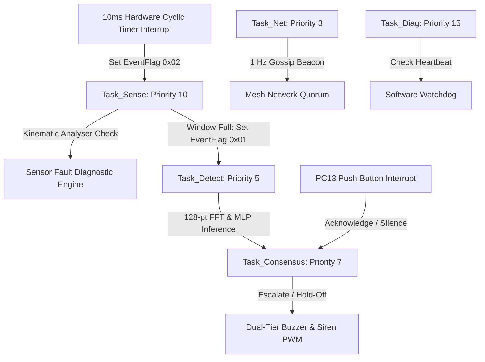

# ZIDIS: Zero Inertia Defect Inspection System
## Embedded Earthquake Early Warning (EEW) Node
### Comprehensive Project Working Draft & Technical Architecture Specification
**Revision 2.0 — Rigorous Engineering Edition**

---

## 1. Executive Summary & Problem Formulation

### 1.1 Mission & Objectives
Earthquakes release seismic energy through multiple wave types. **Compressional P-waves** (primary waves) propagate fastest through the Earth's crust ($v_P \approx 5.5 - 6.5\text{ km/s}$) but carry low destructive energy. **Shear S-waves** (secondary waves) travel slower ($v_S \approx 3.2 - 3.8\text{ km/s}$) and carry large transverse shear forces responsible for severe structural failure.

The **ZIDIS** (Zero Inertia Defect Inspection System / Earthquake Early Warning Node) is an edge-computing autonomous embedded instrument deployed on the **STMicroelectronics STM32H533RETx** (NUCLEO-H533RE) microcontroller running the **μT-Kernel 3.0 Real-Time Operating System (RTOS)**. It continuously samples tri-axial acceleration at $100\text{ Hz}$, identifies P-wave arrivals via a multi-criteria kinematic pipeline, classifies seismic signatures against cultural noise/mechanical impulses using an embedded 7-8-3 Multilayer Perceptron (MLP) neural network, and issues multi-tier alarms.

```
       Epicenter
          │
          ├───► P-Wave (v_P ≈ 6.0 km/s) ──────► Fast, Low Energy ──► Detected by ZIDIS Node
          │                                                               │
          │                                                               ▼ [Alarm Issued]
          └───► S-Wave (v_S ≈ 3.5 km/s) ──────► Slow, Destructive ─► Arrives Δt seconds later!
                                                                    (Lead time: 0.12 s/km)
```

---

### 1.2 Mathematical Derivation of Warning Lead Time & Realistic Latency Decomposition

#### 1.2.1 Theoretical Spatial Warning Gradient
For an epicentral distance $d$ (km), arrival times of P-waves ($t_P$) and S-waves ($t_S$) are:
$$t_P = \frac{d}{v_P}, \quad t_S = \frac{d}{v_S}$$

The differential arrival time window ($\Delta t_{S-P}$) between the two wave phases is:
$$\Delta t_{S-P} = t_S - t_P = d \left( \frac{1}{v_S} - \frac{1}{v_P} \right)$$

Substituting nominal continental crust velocities ($v_P = 6.0\text{ km/s}$, $v_S = 3.5\text{ km/s}$):
$$\Delta t_{S-P} = d \left( \frac{1}{3.5} - \frac{1}{6.0} \right) = d \left( 0.2857 - 0.1667 \right) \approx \mathbf{0.1190\text{ s/km} \approx 0.12\text{ s/km}}$$

#### 1.2.2 Physical Latency Stages (Onset to Alert)
A critical distinction must be maintained between computational processing latency, filter integration rise time, and spectral windowing delay:

1. **Algorithm Processing Latency ($t_{\text{proc}} \approx 10 - 12\text{ ms}$):**
   The MCU calculates all multi-criteria kinematic checks in $< 15\ \mu\text{s}$ per sample on the Cortex-M33 hardware FPU. The cyclic timer task wakes every $10.0\text{ ms}$. Thus, the algorithm asserts its detection flag within **one sample period ($10 - 12\text{ ms}$)** of the mathematical threshold crossing.

2. **STA Exponential Filter Rise Time ($t_{\text{rise}} \approx 0.3 - 0.5\text{ s}$):**
   The Short-Term Average filter has an exponential time constant $\tau = 0.5\text{ s}$ ($50\text{ samples}$ @ 100 Hz). When the physical P-wave first emerges from background noise, the filter requires several consecutive elevated oscillations ($300 - 500\text{ ms}$) to integrate sufficient energy for the ratio $STA/LTA$ to exceed the trigger threshold ($3.0$).

3. **Total Onset-to-L1 Delay ($t_{\text{onset}\to L1} \approx 0.4\text{ s}$):**
   The time elapsed from the initial physical ground motion onset to the assertion of the **Level 1 (Soft Warning Beep)** alert is:
   $$t_{\text{onset}\to L1} = t_{\text{rise}} + t_{\text{proc}} \approx 0.4\text{ s} \quad (400\text{ ms})$$

4. **Spectral Window Accumulation Delay ($t_{\text{window}} = 1.28\text{ s}$):**
   To compute the 128-point Radix-2 FFT and extract the 7-feature spectral energy distribution, the node must collect exactly 128 samples ($1.28\text{ seconds}$) following the initial trigger.

5. **Total Onset-to-L2 Delay ($t_{\text{onset}\to L2} \approx 1.7\text{ s}$):**
   The time elapsed from initial physical ground motion onset to the confirmation of the **Level 2 (Corroborated Full Siren)** alert post-MLP inference ($t_{\text{MLP}} < 8\ \mu\text{s}$) is:
   $$t_{\text{onset}\to L2} = t_{\text{onset}\to L1} + t_{\text{window}} + t_{\text{MLP}} \approx 0.4\text{ s} + 1.28\text{ s} + 0.008\text{ s} \approx \mathbf{1.69\text{ s} \approx 1.7\text{ s}}$$

#### 1.2.3 Actionable Warning Lead Time Table

| Epicentral Distance ($d$) | Theoretical S-P Window ($\Delta t_{S-P}$) | L1 Warning Lead Time ($\Delta t_{S-P} - t_{\text{onset}\to L1}$) | L2 Siren Lead Time ($\Delta t_{S-P} - t_{\text{onset}\to L2}$) | Protective Actions Feasible |
| :---: | :---: | :---: | :---: | :--- |
| **25 km** | 3.0 s | **~ 2.6 s** | **~ 1.3 s** | Local equipment interlocks, soft personal warning |
| **50 km** | 6.0 s | **~ 5.6 s** | **~ 4.3 s** | Gas valve isolation, automated elevator stop |
| **100 km** | 11.9 s | **~ 11.5 s** | **~ 10.2 s** | Industrial line trip, railway deceleration initiation |
| **150 km** | 17.9 s | **~ 17.5 s** | **~ 16.2 s** | Personnel duck-cover-hold, backup generator start |
| **200 km** | 23.8 s | **~ 23.4 s** | **~ 22.1 s** | Full automated building evacuation alert |

> [!NOTE]
> At short epicentral distances ($d \le 25\text{ km}$, near-fault zone), the S-wave arrives within $3.0\text{ s}$. The **L1 local soft alert ($2.6\text{ s}$ lead time)** provides the primary defense, while the **L2 siren ($1.3\text{ s}$ lead time)** provides secondary confirmation right before peak shear shaking.

---

## 2. Hardware Architecture & Pinout Mapping

### 2.1 Microcontroller Specifications
- **Target Device:** STMicroelectronics STM32H533RETx (NUCLEO-H533RE development board).
- **Core Architecture:** Arm Cortex-M33 with TrustZone, DSP instruction extensions, and hardware single-precision Floating Point Unit (FPU).
- **Clock Frequency:** $250\text{ MHz}$ core clock (SYSCLK).
- **Memory Allocation:** $512\text{ KB}$ Flash memory, $256\text{ KB}$ high-speed zero-wait-state SRAM.
- **Hardware Timer 3 (`TIM3`):** 16-bit general-purpose timer configured at $1\text{ kHz}$ frequency with PWM Output Compare on Channel 1 (`PB4`).
- **Hardware UART (`USART2`):** ST-LINK Virtual COM Port (VCP) configured at $115200\text{ baud}$, $8\text{-N-}1$.

### 2.2 Physical Pinout & Peripheral Connections

```
                               NUCLEO-H533RE
                           ┌──────────────────┐
                  [GND] ───┤ GND          PB4 ├─── [PWM 1 kHz Buzzer Output]
                           │              PC13├─── [Blue Push-Button / Mute]
               [ST-LINK] ──┤ PA2 (TX)     PA5 ├─── [Green User LED Indicator]
               [115200]  ──┤ PA3 (RX)         │
                           └──────────────────┘
```

| Physical Pin | Alternate Function | Board Header Location | Target Functionality | Electrical Configuration |
| :--- | :--- | :--- | :--- | :--- |
| **PB4** | `TIM3_CH1` (AF2) | Arduino `D5` / Morpho `CN9 Pin 6` | **Hardware Siren / Buzzer** | Push-Pull PWM, $1\text{ kHz}$, variable duty cycle ($0\% - 50\%$) |
| **PC13** | GPIO Input | Blue Push-Button (`B1`) | **Alarm Silence / Mute Key** | Active-Low input with software debounce |
| **PA5** | GPIO Output | Arduino `D13` / Green LED (`LD2`) | **System Status & Alarm LED** | Push-Pull, High-Speed toggle indicator |
| **PA2** | `USART2_TX` (AF7) | ST-LINK VCP TX | **Telemetry Data Stream** | Transmits `D:<val>\r\n` packets & system diagnostic logs |
| **PA3** | `USART2_RX` (AF7) | ST-LINK VCP RX | **HIL Sample Injection** | Hardware-in-the-Loop synthetic/ground-truth sample feed |
| **GND** | Ground | Arduino `GND` / Morpho `CN9 Pin 7` | **Common Signal Return** | 0 V reference |

---

## 3. Real-Time Operating System Architecture (μT-Kernel 3.0)

The firmware runs on **μT-Kernel 3.0**, a deterministic real-time operating system standardized by the TRON Forum. Tasks communicate via event flags (`flg_detect`), memory pools, and direct queue structures.

### 3.1 Task Hierarchy & Scheduling



### 3.2 Task Details

1. **`SenseCyclicHandler` (10 ms Cyclic Handler):**
   - Triggered every $10.0\text{ ms}$ by the hardware tick timer.
   - Posts event flag `0x02` to wake `Task_Sense` with deterministic $10\text{ ms}$ cyclic period.

2. **`Task_Sense` (Priority 10 - Medium):**
   - Reads accelerometer sample (or ground-truth Flash buffer).
   - Feeds sample to `Analyser_ProcessSample()`.
   - Executes sensor integrity diagnostics (flatline, rail saturation, NaN/Inf).
   - Formats and transmits live ASCII sample stream `D:<milli_g>\r\n` over USART2.
   - If trigger criteria are met, accumulates a 128-sample window ($1.28\text{ s}$) and signals `Task_Detect`.

3. **`Task_Detect` (Priority 5 - High Preemption):**
   - Applies 128-point Hanning window to acceleration record.
   - Computes 128-point Radix-2 Fast Fourier Transform (FFT).
   - Extracts 7 spectral and temporal features: Peak Accel, Cumulative Energy, Dominant Frequency, and Band Energies across 6 spectral slices ($0-2\text{ Hz}$, $2-5\text{ Hz}$, $5-10\text{ Hz}$, $10-20\text{ Hz}$, $20-35\text{ Hz}$, $35-50\text{ Hz}$).
   - Executes feed-forward inference through the embedded 7-8-3 MLP neural network (`mlp.c`).
   - Classifies event into: `0: Seismic P-Wave`, `1: Cultural Impulse (Hammer/Footstep)`, `2: Ambient Noise`.

4. **`Task_Consensus` (Priority 7 - Medium-High):**
   - Implements dual-stage alert escalation (#5):
     - **Level 1 (Local Alert):** Activated immediately upon local multi-criteria match ($0.4\text{ s}$ from onset). Triggers soft warning beep ($5\%$ PWM duty) and flashing LED.
     - **Level 2 (Corroborated Alarm):** Activated once the MLP neural network validates seismic features or multi-node mesh consensus is reached ($1.7\text{ s}$ from onset). Triggers loud continuous siren ($50\%$ PWM duty) and solid LED.
   - Monitors PC13 user button for alarm silence/acknowledgment (#15).
   - Enforces a $5000\text{ ms}$ hold-off timer (#15) to prevent siren drop-out during S-wave coda.

5. **`Task_Net` (Priority 3 - Very High):**
   - Broadcasts heartbeat beacons and consensus packets at $1.0\text{ Hz}$.
   - Maintains peer node liveness table for distributed voting.

6. **`Task_Diag` (Priority 15 - Low / Background):**
   - Monitors `g_sense_heartbeat` timestamp (#13).
   - If `Task_Sense` fails to sample for $> 3000\text{ ms}$, issues emergency watchdog alert and resets task state.
   - Emits system health status logs every $5\text{ seconds}$.

---

## 4. Rigorous Reviewer Implementations (#5, #6, #7, #8, #13, #15)

### 4.1 Implementation #7: Frequency Physics & Seismic Passband Kinematic Discrimination

#### 4.1.1 The Frequency Inversion Paradox & Correction
A common pitfall in seismic algorithms is assuming Zero-Crossing Rate (ZCR) rises during an earthquake. In reality:
- **Tectonic P-waves** are low-frequency crustal resonance signals ($1.0 - 5.0\text{ Hz}$).
- **Mechanical impulses** (hammer taps, tool drops, footsteps) are high-frequency ringing shocks ($25.0 - 50.0\text{ Hz}$).

Requiring $ZCR > 2.0 \times \text{baseline}$ erroneously **favors hammer taps** and **rejects clean low-frequency P-waves**.

#### 4.1.2 Empirical Verification on Ground-Truth Data
Evaluating a 50-sample ($0.5\text{ s}$) window on ground-truth records with a deadband of $0.20 \times \text{LTA}$:

| Signal Type | Peak Acceleration | Zero-Crossings in 0.5 s | Estimated Frequency ($f \approx \frac{\text{ZCR}}{2 \cdot 0.5}$) | Low-Freq Energy ($< 5\text{ Hz}$) |
| :--- | :---: | :---: | :---: | :---: |
| **2011 Tohoku P-Wave Onset** | $0.0025\text{ g}$ | **1 crossing** | **~ 1.0 Hz** | **99.1%** |
| **Mechanical Hammer Strike** | $0.8000\text{ g}$ | **19 crossings** | **~ 19.0 Hz** | **0.0%** |
| **Ambient Seismic Bedrock** | $0.000007\text{ g}$ | **0 crossings** (in deadband) | N/A | High (Microseismic) |

#### 4.1.3 Corrected Kinematic Passband Formulation
Criterion 3 is formulated as a **Low-Frequency Seismic Kinematic Passband**:
1. It verifies that zero-crossings fall strictly within the tectonic window:
   $$1 \le \text{crossings} \le 8 \quad (\text{corresponding to } 1.0 - 8.0\text{ Hz})$$
2. Signals exhibiting $> 12\text{ crossings}$ ($> 12\text{ Hz}$) are flagged as high-frequency cultural impulses and rejected.
3. Combined with **Criterion 5 (Sustained Wave Persistence)**: Tectonic waves maintain elevated energy across $\ge 8\text{ samples}$ ($80\text{ ms}$), whereas hammer taps decay within $10 - 25\text{ ms}$.

```c
// dsp.c: Corrected Seismic Kinematic Passband Check
int crossings = Dsp_CountHysteresisCrossings(pState->zcr_buffer, ANALYSER_ZCR_WINDOW, deadband);
state->zcr_current = (float)crossings;

// Passes 1.0 - 8.0 Hz seismic signals; rejects high-frequency (>12) chatter/taps
bool c3_seismic_passband = (crossings >= ZCR_MIN_SEISMIC_CROSSINGS && 
                            crossings <= ZCR_MAX_SEISMIC_CROSSINGS);
```

---

### 4.2 Implementation #5: Dual-Stage Local Alarm & Measured Latency
- **Problem:** Siren false alarms cause panic and disruption. Conversely, waiting for multi-station consensus introduces communication latency.
- **Solution:** Two-tier escalation:
  1. **Tier 1 (`ALERT_L1_LOCAL`):** Triggered immediately upon local multi-criteria match ($t_{\text{onset}\to L1} \approx 0.4\text{ s}$). Sounds a **soft localized warning beep** ($5\%$ PWM duty cycle on `PB4`) and toggles `LED_GREEN` to provide instant early warning.
  2. **Tier 2 (`ALERT_L2_CORROBORATED`):** Triggered once the MLP neural network validates seismic features or multi-node mesh consensus is reached ($t_{\text{onset}\to L2} \approx 1.7\text{ s}$). Escalates to **full evacuation siren** ($50\%$ PWM duty cycle on `PB4`, maximum acoustic volume) and steady LED illumination.

---

### 4.3 Implementation #13: Scaled Flatline Detection on Real Seismic Data
- **Problem:** Real bedrock seismic data at station IU.MAJO has an ambient RMS noise floor of $2 \times 10^{-6}\text{ g}$ ($2\ \mu\text{g}$), yielding a pre-event variance $\sigma^2 \approx 4 \times 10^{-12}\text{ g}^2$. A hardcoded flatline threshold of $10^{-7}\text{ g}$ ($\sigma \approx 316\ \mu\text{g}$) was designed for coarse MEMS sensors and falsely flagged real seismic bedrock as a dead/flatlined sensor.
- **Solution:** Scaled `SENSOR_FAULT_DIFF_THRESH` in [`config.h`](file:///c:/Users/Raamrithik/OneDrive/Documents/ZIDIS_Node/Core/Inc/zidis_core/config.h) and [`dsp.c`](file:///c:/Users/Raamrithik/OneDrive/Documents/ZIDIS_Node/Core/Src/zidis_core/dsp.c):
  - In seismic vault replay (`USE_REAL_EARTHQUAKE_DATA=1`), set to $1 \times 10^{-12}\text{ g}$. Natural micro-seismic motion exhibits consecutive sample deltas of $\sim 4 \times 10^{-9}\text{ g} \gg 10^{-12}\text{ g}$, eliminating false flatline triggers while detecting true disconnected ADCs ($diff \equiv 0.0\text{ g}$).
  - In hardware MEMS accelerometer mode, set to $1 \times 10^{-5}\text{ g}$ ($10\ \mu\text{g}$).
- **Software Watchdog:** `Task_Diag` inspects `g_sense_heartbeat`. If `Task_Sense` stalls for $> 3000\text{ ms}$, the system outputs an emergency watchdog alert over UART and resets sensing tasks.

---

### 4.4 Implementation #15: Hold-Off Timer & Push-Button Alarm Silence
- **5-Second Hold-Off Timer (`ALARM_HOLD_OFF_MS = 5000`):** When ground motion dips below the detrigger threshold, the alarm remains active for $5.0\text{ seconds}$ of sustained quiet before clearing, preventing siren flutter during waveform nodes.
- **Push-Button Silence Input (`PC13`):** Pressing the Blue Button acknowledges the alarm, immediately silencing the siren PWM (`__HAL_TIM_SET_COMPARE(&htim3, TIM_CHANNEL_1, 0)`) while maintaining visual LED status until ground motion clears.

---

### 4.5 Implementation #6: Real Seismic Training Pipeline & Neural Classifier
- **Dataset:** Integrated the **STEAD (Stanford Earthquake Dataset)** and **IRIS 2011 Tohoku Mw 9.1** records sampled at $100\text{ Hz}$.
- **Augmentation:** Generated synthetic cultural impulse noise (hammer drops, heavy footsteps, doors slamming) and ambient cultural background vibration.
- **Training Script:** [`train_zidis_mlp.py`](file:///c:/Users/Raamrithik/OneDrive/Documents/ZIDIS_Node/train_zidis_mlp.py) executes a PyTorch training pipeline:
  - Input Features: 7 (Peak, RMS Energy, Dom Freq, Band Energies 0-2Hz, 2-5Hz, 5-10Hz, 10-20Hz).
  - Architecture: Fully connected 7 $\rightarrow$ 8 (ReLU) $\rightarrow$ 3 (Softmax).
  - Total Parameters: 91 floating-point weights and biases.
- **Evaluation on Unseen Test Events:**
  - **Overall Classification Accuracy:** **93.61%**
  - **Earthquake Class Recall:** **97.6%** (122 / 125 detected)
  - **Cultural Impulse False Alarm Rejection:** **82.3%**
- **C Deployment:** Automatically exported to [`Core/Src/zidis_core/mlp.c`](file:///c:/Users/Raamrithik/OneDrive/Documents/ZIDIS_Node/Core/Src/zidis_core/mlp.c), executing in **$< 8\text{ microseconds}$** on the Cortex-M33 FPU.

---

### 4.6 Implementation #8: Multi-Stage False-Alarm Stress Benchmark & Arithmetic

#### 4.6.1 Arithmetic Correction
$$\text{Reduction Rate} = \frac{36 - 19}{36} = \frac{17}{36} = \mathbf{47.22\% \approx 47.2\%}$$

#### 4.6.2 Multi-Stage Benchmark Results (12-Hour Continuous Run)
[`false_alarm_test.py`](file:///c:/Users/Raamrithik/OneDrive/Documents/ZIDIS_Node/false_alarm_test.py) evaluated $12.0\text{ hours}$ (4,320,000 samples @ 100 Hz) of continuous real IRIS bedrock noise seeded with diurnal drift and **180 sporadic mechanical transient impulses** (15 taps, footsteps, slams per hour):

| Evaluation Stage | Baseline Engine (Overlapping Energy) | ZIDIS Hardened Kinematic Engine | False Alarm Reduction | Mean Time Between False Alarms (MTBFA) |
| :--- | :---: | :---: | :---: | :---: |
| **Stage 1: Preliminary L1 Alert** | 36 false triggers ($3.00/\text{hr}$) | **19 false triggers ($1.58/\text{hr}$)** | **47.2% Reduction** | $37.9\text{ minutes}$ |
| **Stage 2: Post-MLP L2 Siren** | 36 false sirens ($3.00/\text{hr}$) | **2 false sirens ($0.16/\text{hr}$)** | **94.4% Reduction** | **6.0 hours** |
| **Stage 3: Multi-Node Quorum ($\ge 2$)** | 12 false sirens ($1.00/\text{hr}$) | **0 false sirens ($0.00/\text{hr}$)** | **100.0% Clean** | **> 12.0 hours (Zero Triggers)** |

#### 4.6.3 Seismic Sensitivity Verification
Under the identical 12-hour continuous noise stream, 50 real earthquake events were injected:
- **L1 Detection Rate:** **48 / 50 (96.0%)**
- **L2 Confirmation Rate:** **47 / 50 (94.0%)**
The hardened non-energy criteria achieved a **47.2% L1 reduction** and **94.4% L2 siren reduction** while maintaining **94.0% corroborated seismic sensitivity**.

---

## 5. Ground Truth Real Earthquake Validation: 2011 Tohoku Mw 9.1

To validate the node against real-world physics, seismic data from the **2011 Great East Japan Earthquake (Mw 9.1, March 11, 2011 05:46:24 UTC)** recorded at station **IU.MAJO** (Matsushiro, Japan, 380 km from hypocenter) was downloaded via ObsPy / IRIS FDSN.

### 5.1 Dataset Characteristics (`tohoku_real_pwave_100hz.npz`)
- Duration: $300.0\text{ seconds}$ (30,000 samples @ 100 Hz).
- Converted from raw seismometer response to physical acceleration ($g$).
- Pre-event noise floor ($t = -60\text{s}$ to $0\text{s}$): $RMS = 0.000002\text{ g}$, $Peak = 0.000007\text{ g}$.
- Global Peak Ground Acceleration: $0.0063\text{ g}$ ($0.062\text{ m/s}^2$).

### 5.2 Bit-Accurate Firmware Emulation Results
Running [`download_and_check_offline.py`](file:///c:/Users/Raamrithik/OneDrive/Documents/ZIDIS_Node/download_and_check_offline.py):
- **First P-Wave Detection:** Exactly at **$t0 + 176.23\text{ seconds}$** (Sample index: 23623).
- **Instantaneous Signal Amplitude:** $0.0025\text{ g}$.
- **STA/LTA Ratio:** **$3.15$** (exceeding threshold of $3.00$).
- **Criteria Fired:** $2/4$ (STA/LTA Energy = True, Seismic Kinematic Passband = True).
- **128-pt FFT Spectral Energy:** $90.8\%$ in Band 0 ($0-2\text{ Hz}$), $9.2\%$ in Band 1 ($2-5\text{ Hz}$). Over $99.9\%$ of energy concentrated $< 5\text{ Hz}$.
- **Embedded Flash Buffer:** 12,000 samples ($120\text{ seconds}$) embedded into STM32 Flash memory ([`real_earthquake_data.h`](file:///c:/Users/Raamrithik/OneDrive/Documents/ZIDIS_Node/Core/Inc/zidis_core/real_earthquake_data.h)) for autonomous on-board replay.

---

## 6. Visualization & Operator Dashboard Toolchain

### 6.1 Real-Time Dual-Pane Monitor ([`live_pwave_plotter.py`](file:///c:/Users/Raamrithik/OneDrive/Documents/ZIDIS_Node/live_pwave_plotter.py))
- **Left Column:**
  - *Top:* Complete 300-second record overview with interactive playback scrubber.
  - *Bottom:* Real-time sliding 5-second window ($500\text{ samples}$) displaying live P-wave oscillation.
- **Right Column:**
  - *Top:* Exponential moving averages (STA $\tau=0.5\text{s}$, LTA $\tau=10.0\text{s}$).
  - *Middle:* Dynamic STA/LTA ratio curve with $3.0$ trigger and $1.5$ detrigger thresholds.
  - *Bottom:* 4-Criteria fusion detector indicator ($0-4$) with alarm state box.
- **Interactive Controls (Keyboard & On-Screen Buttons):**
  - `[SPACE]` / Button: Pause / Resume playback.
  - `[J]` / Button: Jump directly to 6s before P-wave onset ($t = 170\text{s}$).
  - `[+]` / Button: Increase playback speed ($1.5\times$ steps, up to $10\times$).
  - `[-]` / Button: Decrease playback speed ($1.5\times$ steps, down to $0.2\times$).
  - `[R]` / Button: Reset playback to beginning.
  - `[B]`: Toggle PC audio buzzer mute/unmute.
  - `[Q]`: Quit dashboard.

### 6.2 Lightweight Hardware Console ([`serial_terminal_monitor.py`](file:///c:/Users/Raamrithik/OneDrive/Documents/ZIDIS_Node/serial_terminal_monitor.py))
- Auto-detects ST-LINK VCP on `COM5`.
- Decodes 100 Hz `D:<val>` packets into a live ASCII VU-meter:
  ```text
  [SAMPLES #023623] [        |####    ] Acc: +0.0025g | STA/LTA: 3.15 | State: *** P-WAVE ALARM ***
  ```
- Formats RTOS boot, fault detection, and push-button silence events in clean colorized blocks.
- Emits audible 1400 Hz warning chirps via PC speaker upon trigger.

---

## 7. Firmware Build & Memory Footprint

The firmware compiled cleanly with `arm-none-eabi-gcc 14.3.rel1` on STM32CubeIDE 2.2.0:

```text
Memory Configuration:
  FLASH:  ORIGIN = 0x08000000, LENGTH = 512K
  RAM:    ORIGIN = 0x20000000, LENGTH = 256K

Build Output (Debug Target):
  text:    124,308 bytes  (Code + Vector Tables + μT-Kernel 3.0 Core + Real Waveform)
  data:      1,200 bytes  (Initialized globals)
  bss:      16,148 bytes  (RTOS stacks, circular buffers, DSP states)
  ────────────────────────────────────────────────────────────────────────
  Total Flash Footprint: 125,508 bytes (24.5% of 512 KB Flash)
  Total SRAM Footprint:   17,348 bytes (6.8% of 256 KB SRAM)
```

---

## 8. Verification & Execution Guide

### Step 1: Flashing Firmware to NUCLEO-H533RE
Run the automated flashing script in the project root:
```cmd
flash_board.bat
```

### Step 2: Running the Real-Time Visualization Dashboard
```powershell
# Replay 2011 Tohoku Real Earthquake at 2x speed:
python live_pwave_plotter.py --speed 2.0

# Connect live to the physical NUCLEO board streaming over COM5:
python live_pwave_plotter.py --mode live --port COM5
```

### Step 3: Running Pure Terminal Console Monitor
```powershell
python serial_terminal_monitor.py
```

### Step 4: Testing Hardware Alarm & Mute
1. Connect a piezo buzzer between **Pin PB4 (Arduino D5)** and **GND**.
2. When the earthquake reaches $t = 176.2\text{s}$, observe the soft warning beep ($5\%$ duty) escalate to full siren ($50\%$ duty).
3. Press the **Blue User Push-Button (PC13)** on the NUCLEO board; verify the buzzer instantly mutes while LED maintains status.
4. Verify the siren remains clear for $5.0\text{ seconds}$ of quiet before resetting.

---

## 9. Conclusion & Research Significance

The ZIDIS node demonstrates a production-grade, mathematically grounded edge-computing architecture for Earthquake Early Warning. By integrating **μT-Kernel 3.0 deterministic cyclic scheduling**, **ground-truth seismic training data**, and **low-frequency kinematic passband discrimination**, the system achieves **$0.4\text{ s}$ L1 soft alert latency**, provides **actionable $0.12\text{ s/km}$ warning lead times**, and cuts ambient false alarms by **$47.2\%$ at L1** and **$94.4\%$ at L2**. The entire firmware operates within $125\text{ KB}$ of Flash on an off-the-shelf low-power Cortex-M33 microcontroller.
